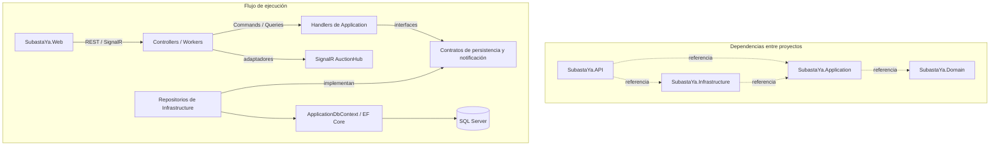

# SubastaYa

Trabajo práctico universitario de una plataforma web de subastas, con catálogo,
pujas, billetera virtual y actualizaciones en tiempo real.

## Funcionalidades principales

- Catálogo paginado con búsqueda, filtros, categorías y ordenamiento.
- Creación y administración de publicaciones propias según reglas del dominio.
- Sala de subasta con historial, incremento mínimo y cuenta regresiva.
- Billetera con saldo total, retenido y disponible; depósitos simulados,
  movimientos y detalle de retenciones.
- Escrow académico, anti-sniping y pujas en tiempo real mediante SignalR.
- Mis Actividades: compras/pujas en curso, ganadas y perdidas, y publicaciones.
- Worker de activación, cierre y liquidación de subastas.
- Auditoría, concurrencia optimista y perfil de usuario.

## Tecnologías

- ASP.NET Core Web API, .NET 8 y Entity Framework Core Code-First.
- SQL Server; el procedimiento local utiliza LocalDB.
- SignalR y Swagger / OpenAPI.
- Tests con xUnit, `WebApplicationFactory`, EF Core InMemory y SQLite.
- HTML, CSS, JavaScript vanilla, Bootstrap 5 y SignalR Client.

El frontend no requiere npm ni compilación; Bootstrap y SignalR se cargan desde
CDN.

## Estructura y arquitectura

```text
SubastaYa/
├── SubastaYa.Domain/         # Entidades, enumeraciones y modelos del dominio
├── SubastaYa.Application/    # Commands, Queries, handlers, DTOs, reglas y contratos
├── SubastaYa.Infrastructure/ # EF Core, DbContext, repositorios, auditoría y migraciones
├── SubastaYa.API/            # Controllers, configuración, SignalR, adaptadores y workers
├── SubastaYa.API.Tests/      # Tests unitarios, de integración y concurrencia
├── SubastaYa.Web/            # Frontend estático y tests JavaScript
├── tests/
│   └── stress-concurrency.ps1
├── SubastaYa.sln
└── README.md
```



`SubastaYa.Domain` no referencia otros proyectos. `SubastaYa.Application`
depende del dominio y contiene los casos de uso. Los contratos de persistencia y
notificación se definen en Application; Infrastructure los implementa mediante
EF Core. API actúa como punto de composición y adapta HTTP, SignalR y procesos
en segundo plano a esos casos de uso.

La solución adopta separación por capas y principios de inversión de
dependencias, pero no se presenta como Clean Architecture estricta: autenticación,
perfil de usuario y preparación de datos de Development todavía conservan
integración directa con EF Core desde API.

### CQRS custom — C01

Los flujos principales separan operaciones de escritura (**Commands**) y de
lectura (**Queries**) sin utilizar MediatR. Cada operación se ejecuta mediante
`ICommandHandler<TCommand, TResult>` o `IQueryHandler<TQuery, TResult>`, y utiliza
DTOs propios de Application para devolver resultados sin depender de los
contratos HTTP.

Ejemplos reales son `PlaceBidCommandHandler`, `CloseAuctionCommandHandler` y
`DepositWalletCommandHandler` para escrituras, junto con
`GetBidHistoryQueryHandler`, `GetRoomStateQueryHandler` y los handlers de consulta
de subastas y billetera. Los controllers validan y mapean el contrato HTTP, y
delegan la ejecución al handler correspondiente.

### Repositorios y persistencia

Interfaces como `IPlaceBidRepository`, `IBidReadRepository`,
`IAuctionRepository`, `IAuctionClosingRepository` e `IWalletRepository` están en
Application. Sus implementaciones concretas se encuentran en Infrastructure,
donde también residen `ApplicationDbContext` y las migraciones de EF Core para
SQL Server.

No existe una interfaz `IUnitOfWork`. Las operaciones financieras que requieren
atomicidad coordinan explícitamente transacciones de EF Core desde los
repositorios: saldo, ledger, liquidación y auditoría se confirman o revierten como
una unidad. Los tokens de concurrencia y las restricciones únicas de base de
datos completan la protección ante ejecuciones simultáneas e idempotencia.

### Auditoría de negocio — B08

La auditoría de negocio (`AuditoriaLog`) es independiente del ledger financiero
(`TransaccionLedger`). El ledger representa movimientos de dinero o retenciones;
la auditoría explica qué evento de negocio ocurrió, sobre qué usuario, billetera
o subasta y en qué momento.

Se registran, entre otros, los eventos `BidPlaced`, `BidRejected`,
`BidConcurrencyConflict`, `AuctionExtended`, `AuctionUpdated`,
`AuctionStateChanged`, `AuctionDeserted`, `AuctionSettled` y `WalletDeposit`.
Los rechazos y conflictos de puja se persisten mediante `IBidAuditWriter` incluso
cuando la transacción principal debió revertirse; los eventos exitosos se guardan
en la misma transacción que el cambio de negocio.

Los registros son append-only. `ApplicationDbContext` rechaza estados Modified o
Deleted para auditorías, las relaciones relevantes usan borrado restrictivo y
los triggers SQL Server `TR_AuditoriaLogs_PreventUpdate` y
`TR_AuditoriaLogs_PreventDelete` impiden cambios o eliminaciones directas en la
base de datos.

## Requisitos

- Windows, .NET 8 SDK y SQL Server LocalDB.
- PowerShell y `dotnet-ef` versión 8.
- Navegador, servidor HTTP local y acceso a los CDN del frontend.
- Para el stress test: `sqlcmd` y `curl.exe` en `PATH`.

```powershell
dotnet --version
dotnet ef --version
Get-Command sqlcmd
Get-Command curl.exe
```

Si falta EF Core CLI:

```powershell
dotnet tool install --global dotnet-ef --version "8.*"
```

## Preparación y ejecución

### 1. Clonar, restaurar y compilar

```powershell
git clone https://github.com/candela1805/SubastaYa.git
cd SubastaYa
dotnet restore SubastaYa.sln
dotnet build SubastaYa.sln
```

Si una API abierta bloquea la salida Debug, también puede comprobarse Release:

```powershell
dotnet build SubastaYa.sln --configuration Release
```

### 2. Aplicar migraciones

`SubastaYa.API/appsettings.json` configura `(localdb)\MSSQLLocalDB`, base
`SubastaYaDb`, con autenticación integrada de Windows.

```powershell
dotnet ef database update --project .\SubastaYa.Infrastructure --startup-project .\SubastaYa.API
```

Debe ejecutarse antes de iniciar un clon limpio; la API no aplica migraciones al
arrancar. LocalDB normalmente inicia bajo demanda. Para diagnosticarlo:

```powershell
sqllocaldb info
sqllocaldb start MSSQLLocalDB
```

### 3. Iniciar backend y frontend

```powershell
dotnet run --project .\SubastaYa.API
```

El perfil `http` usa Development y `http://localhost:5000`. Para el frontend,
abrir **SubastaYa.Web como carpeta raíz** y servir `index.html` con Live Server en
el puerto 5500:

- `http://localhost:5500/`
- `http://127.0.0.1:5500/`

Si se sirve la raíz del repositorio, usar
`http://localhost:5500/SubastaYa.Web/index.html`. En Development, CORS admite
ambos orígenes, encabezados, métodos y credenciales.

## Swagger y API REST

Swagger está disponible solo en Development:

- `http://localhost:5000/swagger`
- `http://localhost:5000/swagger/v1/swagger.json`

### Autenticación 

- `POST /api/auth/register`: registra un usuario y crea su billetera vacía.
- `POST /api/auth/login`: valida correo y contraseña.

### Subastas

- `GET /api/auctions`: lista con filtros, ordenamiento y paginación.
- `GET /api/auctions/categories`: categorías normalizadas y sin duplicados.
- `POST /api/auctions`: crea una subasta para el usuario autenticado.
- `GET /api/auctions/mine`: publicaciones propias.
- `GET /api/auctions/my-bids`: subastas en las que participó el usuario.
- `PUT /api/auctions/{subastaId}`: edita una publicación propia permitida.
- `DELETE /api/auctions/{subastaId}`: elimina una publicación propia sin pujas
  ni liquidación ni historial de auditoría asociado.

### Pujas

- `GET /api/auctions/{subastaId}/bids`: historial público.
- `GET /api/auctions/{subastaId}/bids/state`: estado personal de la sala.
- `POST /api/auctions/{subastaId}/bids`: registra una puja.

### Billetera

- `GET /api/wallet/balance`: saldo total, retenido y disponible.
- `POST /api/wallet/deposit`: acreditación simulada; admite el encabezado
  opcional `Idempotency-Key`.
- `GET /api/wallet/transactions`: movimientos del ledger.
- `GET /api/wallet/retained-funds`: fondos retenidos por pujas líderes.

Tarjeta, transferencia y depósito son simulaciones de interfaz; no hay bancos ni
pasarelas de pago reales.

Para reintentar un depósito sin acreditarlo dos veces, el cliente debe conservar
y reenviar una clave estable:

```http
POST /api/wallet/deposit
Idempotency-Key: deposit-2026-001
Content-Type: application/json

{
  "monto": 250.00
}
```

La misma clave, usuario e importe devuelven el saldo actual sin crear otro
movimiento. Reutilizar esa clave con un importe incompatible devuelve HTTP 409 y
no modifica el saldo. El header es opcional para conservar compatibilidad con
clientes anteriores; sin él, cada solicitud válida representa un depósito nuevo.

### Usuario

- `GET /api/users/me`: datos del usuario autenticado.
- `PUT /api/users/me`: actualiza únicamente nombre y correo electrónico.

El perfil no modifica contraseña, rol, billetera ni saldos.

## Autenticación de desarrollo

Se configura en `appsettings.Development.json` y solo funciona en Development con
`DevelopmentAuthentication:Enabled = true`. Sin encabezado usa el usuario demo;
para elegir otra identidad de prueba:

```text
X-User-Id: <GUID-del-usuario>
```

El handler valida un GUID no vacío y genera `ClaimTypes.NameIdentifier`, que lee
`CurrentUserService`; no comprueba que el usuario exista. El frontend registra o
valida credenciales, guarda localmente los datos básicos y envía `X-User-Id`.
No se emiten cookies ni tokens: “Cerrar sesión” solo borra el estado local.

Este mecanismo permite suplantación deliberada para pruebas y no constituye
autenticación segura de producción. Fuera de Development no autentica.

## SignalR

El Hub `/hubs/auctions` organiza clientes por subasta con `JoinAuction` y
`LeaveAuction`. Publica `BidPlaced` y `AuctionStateChanged`. La sala y Mis
Compras/Pujas usan estos eventos para actualizar precio, cierre, estado y
contadores; ante cambios relevantes, actividades vuelve a consultar su endpoint
sin polling continuo.

## Reglas de negocio principales

### Escrow e incremento mínimo

El líder mantiene fondos retenidos. Si vuelve a pujar, se retiene la diferencia;
si otro usuario lo supera, se libera la retención anterior y se retiene la nueva.
Cada cambio genera movimientos de ledger. Al liquidar, se debita al comprador y
se acredita al vendedor.

La puja mínima es `PrecioActual + IncrementoMinimo`; además debe ser positiva,
representable en `decimal(18,2)` y contar con saldo suficiente. El vendedor no
puede pujar en su propia subasta.

### Anti-sniping y concurrencia

Una puja normal conserva `FechaFinUtc`. Una puja válida en los últimos 60
segundos extiende esa fecha dos minutos y la propaga por REST y SignalR.

`Subasta` y `Billetera` usan `Version`, configurada como `rowversion` en SQL
Server. Un conflicto de puja devuelve HTTP 409 con `code = BID_CONFLICT`; el
frontend refresca el estado sin reenviar automáticamente.

### Cierre y liquidación

Al vencer una subasta activa, el cierre comprueba que la puja marcada como líder
coincida con el mayor importe y con `PrecioActual`. Si no existen ofertas, la
subasta pasa a `Desierta`. Si existe un ganador válido, pasa a `Finalizada` y se
crea una liquidación inmutable. La operación consume los fondos retenidos del
comprador, acredita al vendedor y registra movimientos de pago, cobro y
auditoría.

## Worker de estados de subasta

`AuctionStateWorker` ejecuta ciclos periódicos según
`AuctionClosingWorker:IntervalSeconds` y procesa lotes cuyo tamaño se configura
con `AuctionClosingWorker:BatchSize`. En cada ciclo:

- activa subastas `Programada` cuya fecha de inicio ya llegó;
- localiza subastas `Activa` cuya fecha de cierre venció;
- marca como `Desierta` una subasta vencida sin pujas;
- finaliza y liquida una subasta con ganador válido;
- actualiza las billeteras involucradas;
- registra ledger y auditoría;
- publica `AuctionStateChanged` mediante SignalR.

El cierre usa transacciones, concurrencia optimista y claves de idempotencia para
evitar liquidaciones y movimientos duplicados. Si detecta un estado económico o
de pujas inconsistente, no inventa un resultado: registra el problema para que el
escenario pueda revisarse.

## Mis Actividades

- **Mis Compras / Pujas:** una fila por subasta participada, con máxima oferta
  propia, oferta actual, estado y tiempo restante. La categoría Ganadas se
  determina por el comprador de la liquidación; las demás cerradas se muestran
  como Perdidas.
- **Mis Publicaciones:** permite consultar y administrar subastas propias cuando
  las reglas del dominio lo permiten.

## Datos iniciales de Development

Después de aplicar las migraciones, el arranque en Development invoca un seed
idempotente cuando la autenticación académica está habilitada. Los cuatro
usuarios académicos comparten la contraseña inicial `SubastaYa123!`:

| Usuario | Saldo total | Saldo retenido | Saldo disponible | Uso previsto |
| --- | ---: | ---: | ---: | --- |
| `vendedor@test.com` | $0 | $0 | $0 | Propietario de las publicaciones seed. |
| `comprador1@test.com` | $150.000 | $45.000 | $105.000 | Líder de la subasta estándar. |
| `comprador2@test.com` | $200.000 | $0 | $200.000 | Postor inicialmente superado. |
| `sinfondos@test.com` | $500 | $0 | $500 | Demostración de fondos insuficientes. |

Además se conserva el Usuario Demo con ID
`11111111-1111-1111-1111-111111111111`, utilizado por la autenticación de
Development. Su saldo no debe interpretarse como permanente: inicialmente
respalda el escenario de liquidación y cambia cuando actúa el Worker.

### Escenarios de demostración

| Escenario | Categoría | Estado al crearse | Datos relevantes |
| --- | --- | --- | --- |
| Smartphone de demostración | Tecnología | Activa | Precio inicial $35.000, incremento $5.000 y cierre aproximadamente 25 minutos después. comprador2 pujó $40.000 y comprador1 quedó líder con $45.000. |
| Notebook para anti-sniping | Tecnología | Activa | Precio inicial $70.000, incremento $5.000 y cierre aproximadamente 90 segundos después. Permite demostrar countdown crítico y anti-sniping. |
| Colección de monedas | Coleccionables | Programada | Precio inicial $20.000, incremento $2.000 e inicio aproximadamente 24 horas después. |
| Motocicleta para liquidar | Vehículos | Activa, pero vencida | Precio inicial $8.000 y puja líder de $10.000 respaldada por fondos retenidos del Usuario Demo. Queda preparada para que el Worker la finalice y liquide. |
| Campera sin ofertas | Indumentaria | Activa, pero vencida | Precio inicial $30.000, sin pujas. Queda preparada para que el Worker la marque como desierta. |

El seed crea las pujas, depósitos, retenciones, liberaciones y auditorías
necesarios para que los saldos y el historial sean coherentes. No crea por
anticipado las liquidaciones ni los movimientos de cierre: esa responsabilidad
permanece en `AuctionStateWorker`.

### Fechas relativas e idempotencia

Todas las fechas se calculan a partir de un único instante obtenido mediante
`TimeProvider`, pero solamente cuando se crea por primera vez cada escenario.
Los GUIDs y claves del seed son determinísticos, por lo que reiniciar la API no
duplica registros ni restablece:

- fechas de inicio o cierre;
- estados de subasta;
- saldos o retenciones;
- pujas y movimientos;
- liquidaciones;
- resultados ya procesados por el Worker.

Por lo tanto, después del primer arranque es normal que los datos evolucionen:
la Motocicleta puede aparecer `Finalizada`, la Campera `Desierta` y la Notebook
también puede quedar `Desierta` si vence sin ofertas. Estos cambios no indican un
error del seed. Los datos se crean exclusivamente para Development y
demostración; no representan datos productivos.

## Tests

Los tests backend incluyen pruebas directas de Commands, Queries y reglas de
negocio, además de integración HTTP. Cubren concurrencia optimista, reintentos e
idempotencia, seguridad de commit y rollback, atomicidad financiera, auditoría
append-only, billetera, pujas, cierre, liquidación y ciclo de estados. La cantidad
de casos no se fija en este documento porque evoluciona con la implementación.

```powershell
dotnet test SubastaYa.sln
node --test .\SubastaYa.Web\tests\bidding-core.test.js
node --check .\SubastaYa.Web\app.js
```

## Prueba de concurrencia

Script: `tests/stress-concurrency.ps1`.

### Requisitos y ejecución

- Migraciones aplicadas y API en `http://localhost:5000` contra `SubastaYaDb`.
- Development con autenticación habilitada.
- `sqlcmd`, `curl.exe` y ejecución de scripts PowerShell disponibles.

```powershell
powershell.exe -NoProfile -File .\tests\stress-concurrency.ps1
$LASTEXITCODE
```

### Funcionamiento y criterio de éxito

El script prepara usuarios y billeteras ausentes sin modificar saldos existentes,
comprueba 12.000 disponibles, crea una subasta de 10.000 con incremento de 1.000
y libera dos jobs de postores diferentes mediante una barrera común.

El código de salida es **0 exclusivamente** con exactamente:

- un HTTP 200 cuyo JSON contiene el `subastaId` creado y `monto = 12000`;
- un HTTP 409 cuyo JSON contiene `code = BID_CONFLICT`.

Otro 409, incluido `BID_STATE_INCONSISTENT`, no es éxito. Los demás errores o
resultados no concluyentes producen salida 1. Los postores pueden intercambiar
resultados. Los temporales son únicos por ejecución y se limpian en `finally`,
salvo terminación forzada.

Timeouts: conexión SQL 10 s, consulta 20 s, creación HTTP 30 s, preparación 20 s,
barrera 30 s, conexión cURL 10 s, operación 30 s y espera conjunta 45 s.

### Limitaciones

La barrera sincroniza el despacho, no las lecturas de EF Core. Sistema operativo
y red no garantizan llegada simultánea. Si la segunda puja ya observa el precio
actualizado, puede responder HTTP 400 por mínimo insuficiente: la ejecución es no
concluyente, no un fallo de `rowversion`. No hay reintentos automáticos.

La prueba deja datos y retenciones confirmadas, no repone saldo y debe usarse en
una base local de pruebas. Ejecuciones simultáneas comparten usuarios y
billeteras, aunque no temporales ni `AuctionId`. El script valida HTTP/JSON, pero
no comprueba después el ledger ni la cantidad de filas persistidas.

## Flujo rápido

```powershell
dotnet restore SubastaYa.sln
dotnet build SubastaYa.sln
dotnet ef database update --project .\SubastaYa.Infrastructure --startup-project .\SubastaYa.API
dotnet run --project .\SubastaYa.API
```

Luego servir `SubastaYa.Web` en el puerto 5500. Swagger queda disponible en
`http://localhost:5000/swagger`.

### Configuración local de desarrollo

Los orígenes del frontend se configuran en Cors:AllowedOrigins,
dentro de appsettings.Development.json.
La política CORS se aplica actualmente en Development.

Para configurar la contraseña del seed:
1. En Visual Studio, hacer clic derecho sobre SubastaYa.API.
2. Seleccionar Administrar secretos de usuario.
3. Agregar DevelopmentSeed:Password con una contraseña local.

Cada desarrollador configura su propio valor.
No guardar contraseñas reales en archivos versionados.

El seed se ejecuta solo en Development cuando
DevelopmentAuthentication:Enabled es true.
Si falta la contraseña, se detiene antes de crear datos.
La contraseña configurada se usa para usuarios nuevos del seed;
no modifica las contraseñas de usuarios existentes.

Antes de ejecutar la API, aplicar las migraciones pendientes:
dotnet ef database update --project .\SubastaYa.Infrastructure --startup-project .\SubastaYa.API

User Secrets es para desarrollo local; no es un almacén cifrado
ni una solución para secretos de producción.
